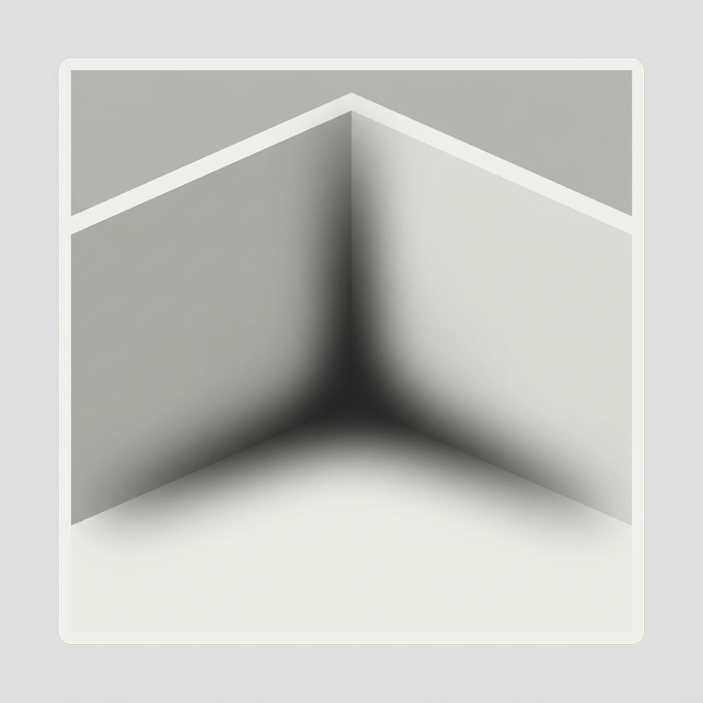
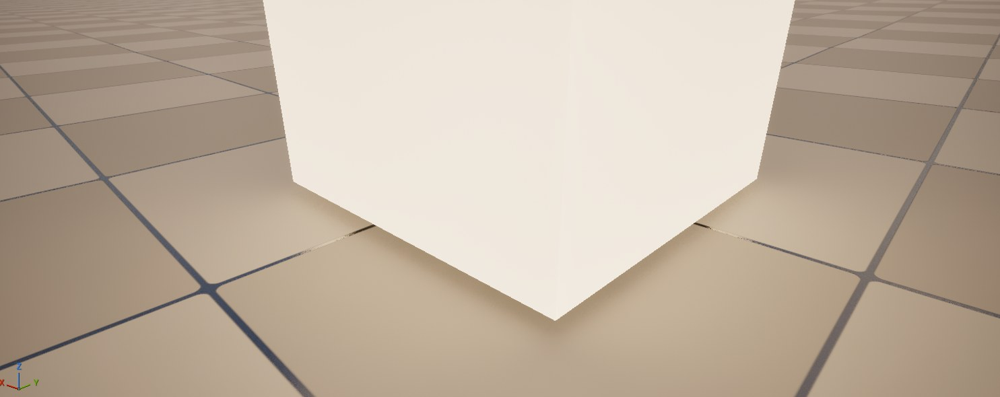
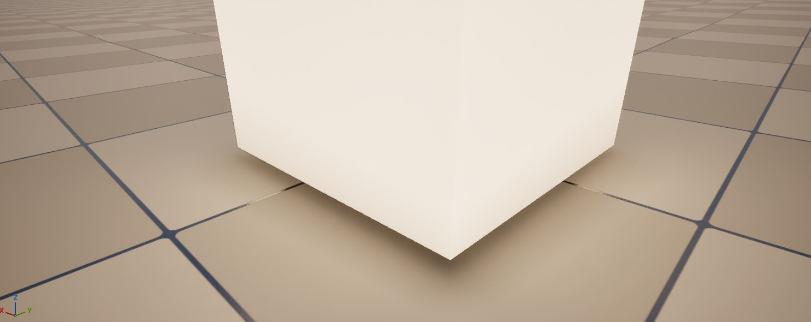

<p align="center">
  
</p>

# GHOSTAO

Powered by rly_ghost

GHOSTAO is a circular-occluder ray-traced ambient occlusion (AO) renderer for Unreal Engine 5,
distributed as a self-contained renderer plugin. It is based on the CORTAO reference
implementation by Daniel Isheden (MIT License).

In practice it means: you drop the plugin into your project, enable it, type two console commands,
and your scene gets high-quality contact shadows and crevice darkening that react to geometry,
without baking, without engine source changes and without any binary assets. It also produces
bent normals, which you can use in your own renderer code for specular occlusion or directional
lighting.

- Works with the deferred renderer, Lumen, Nanite, virtual shadow maps and any temporal upscaler
  (TSR, DLSS, FSR).
- Runs on DirectX 12 and Vulkan.
- Built and tested on Unreal Engine 5.6.1, Windows, RTX 3060 Ti.

## Ambient occlusion in action

The same cube-on-floor scene with GHOSTAO disabled and enabled (UE 5.6, radius 150 cm):

<p align="center">
  
  
</p>

---

## 1. Requirements

| Item | Requirement |
|---|---|
| Engine | Unreal Engine 5.6 (built and tested with 5.6.1) |
| Platform | Windows 64-bit (Win64) |
| RHI | DirectX 12 or Vulkan |
| Shader model | SM5+ (the shaders avoid SM6.7-only features) |
| GPU | discrete GPU; GTX 1660-class is the intended minimum, but it has not been profiled on that hardware yet |
| Project type | any UE project; no engine source code modifications are needed |

The plugin is a **renderer** plugin: it does not contain gameplay code, does not alter existing
materials or post-process settings, and does not touch your project's content.

---

## 2. Installation

### 2.1 Copy the plugin

1. Locate your project folder (the folder that contains `YourProject.uproject`).
2. Create a `Plugins` folder inside it if it does not exist.
3. Copy the whole `GHOSTAO` folder into it, so the result is:

```
YourProject/
  YourProject.uproject
  Plugins/
    GHOSTAO/
      GHOSTAO.uplugin
      README.md
      Resources/
      Source/
      Shaders/
```

### 2.2 Enable the plugin

Option A — in the editor:

1. Open the project.
2. Go to **Edit → Plugins**.
3. Search for **GHOSTAO**, enable it, and click **Restart** when the editor asks.

Option B — in the project file: open `YourProject.uproject` in a text editor and add the entry:

```json
{
	"FileVersion": 3,
	"EngineAssociation": "5.6",
	"Plugins": [
		{ "Name": "GHOSTAO", "Enabled": true }
	]
}
```

> The plugin module loads at `PostConfigInit` because it registers global shaders, so a **full
> editor restart is required** after enabling it. Hot reloading is not enough.

### 2.3 First launch

On the first launch after enabling the plugin, Unreal compiles the plugin's global shaders. This
can take a few minutes on the first run and is cached afterwards (derived data cache). The editor
may appear busy; check **Window → Developer Tools → Output Log** if you want to watch progress.

After this, the plugin is enabled but **inactive** — it does not change the image until you turn
it on (`r.GHOSTAO.Enable 1`). This is intentional, so you can compare on/off and ship it disabled.

---

## 3. Quick start

### 3.1 Open the console

In the editor, press `~` (tilde) or use the dropdown next to the console icon to open the console
command line. Type a command and press `Enter`. Commands are case-sensitive.

### 3.2 Enable AO in four commands

```
r.AmbientOcclusionLevels 0
r.GHOSTAO.Enable 1
r.GHOSTAO.Radius 100
```

What each command does:

- `r.AmbientOcclusionLevels 0` disables Unreal's built-in screen-space AO so you do not get two AO
  effects at once.
- `r.GHOSTAO.Enable 1` turns GHOSTAO on.
- `r.GHOSTAO.Radius 100` sets the occlusion radius to 100 cm (Unreal units are centimeters). This
  is usually the main artistic knob; try `50`–`300` depending on scene scale.

Now look at the scene: crevices, corners, under the car/character, contact between objects and the
ground should become darker and softer than before. Toggle `r.GHOSTAO.Enable 0/1` to compare.

### 3.3 Optional: make it look softer

```
r.GHOSTAO.Intensity 0.7
r.GHOSTAO.SpecularOcclusion 0.25
```

- `Intensity` scales the diffuse AO contribution.
- `SpecularOcclusion` adds a bent-normal-based darkening of specular highlights in crevices.

---

## 4. Verifying it works

### 4.1 Log messages

Open `YourProject/Saved/Logs/YourProject.log` (or the Output Log) and search for `GHOSTAO`. A
working setup prints:

```
[GHOSTAO] Shader directory mapped: /Plugin/GHOSTAO -> <path>
[GHOSTAO] SceneViewExtension registered.
[GHOSTAO] First AO pass dispatch: 1920x1080
```

The first line means the plugin found its shader folder. The second means the render hook is
installed. The third appears the first time the effect actually runs for a view.

If you see none of these, the plugin is not enabled in the `.uproject` or the editor was not
restarted.

### 4.2 GPU statistics

Open the console and type:

```
stat gpu
```

With GHOSTAO enabled you should see the passes:

```
GHOSTAO Prepass
GHOSTAO MainPass
GHOSTAO Temporal
GHOSTAO Composite
```

### 4.3 Debug view

```
r.GHOSTAO.VisualizeBentNormals 1
```

This replaces the final image with the view-space bent normals (rainbow-like colors). Use it to
confirm the effect runs and to inspect the computed directions. Set it back to `0` when done. At
high temporal blend settings the debug view is noisy by design: bent normals are per-frame values
and are meant to be filtered by TAA or by your own temporal accumulation.

---

## 5. Configuration reference

All settings are console variables and can be changed at runtime.

| CVar | Default | What it does | Practical range |
|---|---|---|---|
| `r.GHOSTAO.Enable` | `0` | Master switch for the render hooks. | `0` / `1` |
| `r.GHOSTAO.Radius` | `100` | Occlusion radius in world units (cm): how far the effect looks for occluders. Bigger radius = broader, softer AO. | `20`–`400` |
| `r.GHOSTAO.ScreenRadiusRatio` | `0.2` | Maximum screen-space size of the occlusion disk, as a fraction of the screen height. Prevents huge radii on close objects. | `0.05`–`0.5` |
| `r.GHOSTAO.Temporal` | `1` | Randomizes the sample pattern every frame. Keep it `1` for games; use `0` only for still screenshots. | `0` / `1` |
| `r.GHOSTAO.TemporalBlend` | `0.1` | Weight of the new frame in the temporal accumulation. Lower = smoother, higher = less ghosting. | `0.02`–`1` |
| `r.GHOSTAO.Intensity` | `1.0` | Strength of AO applied to the scene color. `0` = no darkening, `1` = full AO. | `0`–`1` |
| `r.GHOSTAO.SpecularOcclusion` | `0.35` | Strength of the bent-normal specular darkening. `0` = plain AO only. | `0`–`1` |
| `r.GHOSTAO.VisualizeBentNormals` | `0` | Debug view of view-space bent normals. | `0` / `1` |

### 5.1 Tuning advice

- **AO too dark overall**: lower `Intensity` to `0.5`–`0.8` first.
- **AO too dark on directly lit surfaces**: this plugin multiplies the whole scene color, so
  direct light is affected too (see Known limitations). Compensate with a lower `Intensity`
  and/or lower `SpecularOcclusion`.
- **AO too subtle**: raise `Radius` before raising `Intensity`.
- **AO shimmering or noisy**: keep `Temporal 1` and `TemporalBlend 0.1`; another option is to use
  a temporal upscaler (TSR, DLSS, FSR), which runs after GHOSTAO.
- **Ghosting after cuts/teleports**: raise `TemporalBlend` to `0.2`–`0.3`, or set it to `1` to
  disable history entirely.
- **Close-up objects with giant AO halos**: lower `ScreenRadiusRatio` (`0.1`–`0.15`).

### 5.2 Making the settings permanent

Console variables are runtime-only. To make them the project default (and to ship them in a
packaged build), add them to `YourProject/Config/DefaultEngine.ini`:

```ini
[ConsoleVariables]
r.AmbientOcclusionLevels=0
r.GHOSTAO.Enable=1
r.GHOSTAO.Radius=100
r.GHOSTAO.Intensity=0.8
r.GHOSTAO.SpecularOcclusion=0.25
```

These values are applied when the engine starts. This is the recommended way for packaged games,
where the console is usually unavailable.

---

## 6. How it works (plain language)

### 6.1 What ambient occlusion is

AO estimates how much of the surrounding hemisphere at a surface point is blocked by nearby
geometry. A point in a corner or under an object sees less open space, so it receives less ambient
light and should look darker. AO is a cheap approximation of global illumination: it does not
compute real light bounces, it only darkens the ambient/sky contribution in tight spaces.

### 6.2 The circular occluder idea

GHOSTAO does not trace thousands of rays per pixel. For each screen sample it:

1. Reconstructs the 3D position and normal of the visible surface from the depth buffer.
2. Looks at a small set of neighbouring samples of the packed depth/normal buffer.
3. Treats each neighbour as a **circular occluder** in the tangent plane of the surface: a disk
   that blocks a part of the hemisphere.
4. Turns that disk into a direction and an angular radius, and looks it up in a lookup table that
   stores which of the 16 golden-angle rays are covered by such a disk.
5. Occlusion is the fraction of covered rays (0 = fully open, 1 = fully blocked).

The result is temporally accumulated and filtered, then multiplied into the scene color.

### 6.3 Render passes

The effect is registered as a Scene View Extension and runs at the `BeforeDOF` post-processing
location — before TSR/DLSS/FSR, so temporal upscalers also smooth the AO. Each frame the plugin
adds these passes:

1. **Prepass** — reads the scene depth, reconstructs linear depth and a view-space normal from
   depth derivatives, and packs both into one `R32_UINT` texture (depth bits + 10-bit sphere-mapped
   normal). Sky pixels are stored as zero.
2. **Occluder lookup table (LUT)** — a `24 x 24 x 16` 3D texture of ray bitmasks, regenerated on the
   GPU every frame. Every entry describes which rays are covered by a disk with a given direction
   and angular radius. This replaces the per-ray loop with a single texture fetch per sample.
3. **Bent normal LUT** — `2^16` entries (`256 x 256`, `RGBA16F`). For every ray bitmask it stores
   the average direction of the unoccluded rays.
4. **Main pass** — golden-angle samples, occluder resolution through the LUTs, output AO and the
   view-space bent normal.
5. **Filter pass** — a 5-tap spatial prefilter with depth/normal-aware weights. Sky gets AO = 1.
6. **Temporal pass** — reprojects the previous frame with the previous view-projection matrix,
   clamps history to the local AO range to reduce ghosting, and blends. Bent normals are
   accumulated the same way. History is kept per view state and reset when the resolution changes.
7. **Composite** — applies the result to the scene color before the temporal upscaler:
   `color *= lerp(1, AO, Intensity) * lerp(1, specularOcclusion, SpecularOcclusion)`.

### 6.4 What bent normals are

The bent normal is the average direction of the open (unoccluded) part of the hemisphere. In an
open area it points roughly along the surface normal; in a corner or under an object it leans
towards the open direction. It is useful for specular occlusion (highlights should be dimmed where
the reflection direction is blocked) and for directional ambient/GI.

GHOSTAO uses bent normals in its own composite for an approximate specular occlusion term, and
also exposes them to your code (see section 8).

---

## 7. Performance

Measured in the editor viewport with `stat gpu` (averages over the sampling window), 1476x720
render resolution (screen percentage 100), D3D12, Lumen enabled, RTX 3060 Ti:

| Configuration | GPU graphics queue (total) | Post-processing | Delta vs no AO |
|---|---|---|---|
| No AO | 9.77 ms | 1.25 ms | — |
| Unreal built-in SSAO (`r.AmbientOcclusionLevels 2`) | 10.24 ms | 1.30 ms | +0.47 ms |
| GHOSTAO (LUT + temporal + bent normals) | 10.74 ms | 1.73 ms | +0.97 ms |

Notes:

- In this test the editor frame was CPU-bound (~32 fps), so the table compares the GPU cost of the
  three configurations rather than the final fps.
- GHOSTAO replaces the per-ray loop with a GPU-generated lookup table and temporally accumulates
  its output, which keeps its cost around one millisecond at 720p.
- Early measurement: not yet profiled on minimum-spec hardware (GTX 1660 class), in a packaged
  game, or at 1080p with the final quality settings.

### 7.1 How to measure in your project

1. Enable the effect and set the settings you intend to ship.
2. Open the console, type `stat gpu`.
3. Look at `Graphics Queue Total` (overall GPU frame time) and at the `Postprocessing` line.
4. Toggle `r.GHOSTAO.Enable 0/1` and compare the numbers.
5. The effect costs more with: larger `Radius`, higher render resolution, more overdraw; it costs
   less at lower `ScreenPercentage`.

---

## 8. Using bent normals in your own code

This section is for programmer-level integrations (specular occlusion, custom GI, etc.). You can
skip it if you just want the built-in effect.

The plugin exposes the last produced bent normal texture through a small API:

```cpp
#include "GHOSTAOApi.h"

// Render thread only.
TRefCountPtr<IPooledRenderTarget> BentNormals = GHOSTAO::GetBentNormalTexture(View.State);
if (BentNormals.IsValid())
{
	FRDGTextureRef Texture = GraphBuilder.RegisterExternalTexture(BentNormals, TEXT("GHOSTAO.BentNormals"));
	// Texture: PF_FloatRGBA, size = scene color extent.
	// .xyz = view-space bent normal (average unoccluded direction), .w = 1 for valid pixels, 0 for sky.
}
```

Details:

- The function must be called on the **render thread**, inside a render graph context (for example
  from your own Scene View Extension or renderer pass).
- The texture is produced for each view that renders GHOSTAO that frame. It is the accumulated
  (temporally filtered) result, but it is still a per-frame signal: filter it further with TAA or
  your own accumulation if you need it perfectly stable.
- The values are in **view space**. Transform them to world space with the inverse view matrix if
  your algorithm expects world space.
- Your module must depend on `RenderCore` (for `IPooledRenderTarget` / RDG types). In a `.Build.cs`:
  `PrivateDependencyModuleNames.AddRange(new string[] { "Core", "CoreUObject", "Engine", "RenderCore", "RHI" });`

---

## 9. DirectX 12 / Vulkan

The plugin works on both RHI backends; the RHI is chosen by the engine, not by the plugin.

- In the editor: **Project Settings → Platforms → Windows → Default RHI**.
- From the command line: `UnrealEditor.exe YourProject.uproject -d3d12` or `-vulkan`.
- In a packaged game, the same project setting is used.

The first launch on Vulkan compiles all engine shaders for the Vulkan platform and can take a long
time; later launches reuse the derived data cache.

---

## 10. Compatibility

- Renderer: deferred only. Tested with Lumen, Nanite, virtual shadow maps, and with TSR on and off.
- Temporal upscalers (TSR/DLSS/FSR): supported; they run after GHOSTAO and also smooth its output.
- Materials: no GBuffer dependency, so any material and shading model works, including custom ones.
- Unreal's own SSAO: can stay enabled, but you get double AO. Disable it with
  `r.AmbientOcclusionLevels 0`, or compare with `r.GHOSTAO.Enable 0`.
- Not tested: forward shading, mobile, VR, consoles. The code uses standard RDG/compute features,
  but no certification has been done.

---

## 11. Troubleshooting

| Symptom | Likely cause | Fix |
|---|---|---|
| Nothing changes after `r.GHOSTAO.Enable 1` | Plugin not enabled in the `.uproject`, or editor not restarted | Enable it in **Edit → Plugins**, restart the editor, check for `[GHOSTAO]` lines in the log |
| First launch takes minutes / editor seems frozen | Global shaders are compiling | Wait; watch `LogShaderCompilers` in the Output Log. Later launches use the cache |
| Log shows `Shader directory mapped` but no dispatch | The view never rendered with the effect enabled, or the console variable was set in a different world | Make sure the viewport is rendering (real-time viewport), then re-run `r.GHOSTAO.Enable 1` |
| AO is too dark | `Intensity` too high; AO also darkens direct light | Lower `r.GHOSTAO.Intensity`, then `r.GHOSTAO.SpecularOcclusion` |
| AO is too weak | Radius too small for the scene scale | Raise `r.GHOSTAO.Radius` (scene units are cm) |
| Noise / flicker | Temporal accumulation disabled or TAA/upscaler off | Keep `r.GHOSTAO.Temporal 1`, `TemporalBlend 0.1`; enable TSR/DLSS/FSR |
| Ghosting after camera cuts or teleports | History from a different view | Raise `TemporalBlend` to `0.2`–`0.3`, or set `TemporalBlend 1` |
| Huge AO halos on close objects | Screen-space radius cap too high | Lower `r.GHOSTAO.ScreenRadiusRatio` |
| Editor crash while compiling global shaders | Plugin files moved/renamed or shader folder missing | Keep the folder name `GHOSTAO` and the module name `GHOSTAO` in sync; verify `Shaders/Private` exists |
| Vulkan first start takes very long | Vulkan shader compilation | Expected once; subsequent launches use the cache |

If something is off, always check `YourProject/Saved/Logs/YourProject.log` for `[GHOSTAO]` and
`LogShaderCompilers` lines first.

---

## 12. FAQ

**Does it work with Lumen/Nanite?**
Yes, both were tested. GHOSTAO only reads the depth buffer and multiplies the final scene color, so
it is independent of the lighting path.

**Does it need a specific anti-aliasing mode?**
No. With TSR/DLSS/FSR the AO is additionally smoothed by their temporal accumulation. With no AA at
all the temporal pass still removes most of the noise; the debug bent normal view is noisier by
design.

**Does it affect performance much?**
About one millisecond of GPU time at 720p on the test GPU, depending on radius and resolution (see
section 7).

**Can I use it in a packaged game?**
Yes. Put the settings into `DefaultEngine.ini` (section 5.2); the plugin and its shaders are cooked
and included automatically.

**Does it work in a shipping build?**
The plugin ships as a normal runtime plugin. Enable it in the `.uproject`, set the defaults in
`DefaultEngine.ini`, and package as usual.

**Can I disable it for low-end machines?**
Yes: `r.GHOSTAO.Enable 0` (runtime) or remove/disable the plugin entry (build-time). It is
dormant by default.

**Why does AO darken directly lit surfaces too?**
Because the plugin applies AO to the whole scene color; routing it through the engine's
`FSceneTextures::ScreenSpaceAO` would require patching the Renderer module and building a custom
engine, which this plugin intentionally avoids. Use `Intensity`/`SpecularOcclusion` to compensate.

**Where is the source of truth for defaults?**
The CVar declarations in `Source/GHOSTAO/Private/GHOSTAORenderer.cpp` and
`Source/GHOSTAO/Private/GHOSTAOModule.cpp`; this README mirrors them.

---

## 13. Known limitations

- AO is applied to the whole scene color, including direct light (see section 6.3 and 12).
- Normals are reconstructed from depth (no GBuffer dependency), so geometry edges can be slightly
  noisy.
- The packed depth/normal buffer has no mip chain yet, so very large-radius samples at long
  distances are less accurate than in the reference implementation.
- Bent normals are view-space and per-frame; consumers should filter them.
- Temporal accumulation can ghost when the previous frame cannot be reprojected (hard camera cuts,
  teleports); neighborhood clamping reduces but does not eliminate it.
- Vulkan was verified to run the same code path; both RHIs are expected to behave identically.

---

## 14. Uninstalling

1. Disable the plugin (or remove the `GHOSTAO` entry from the `.uproject`).
2. Delete `YourProject/Plugins/GHOSTAO`.
3. Restart the editor.

The plugin owns no assets, so nothing else needs to be cleaned up, apart from GHOSTAO console
variables you may have added to `DefaultEngine.ini`.

---

## 15. File layout

```
Plugins/GHOSTAO/
  GHOSTAO.uplugin                     plugin descriptor (Runtime module, PostConfigInit)
  README.md                           this document
  Resources/Icon128.png               plugin icon
  Shaders/Private/
    GHOSTAOCommon.ush                 packing, spheremap, sampling helpers
    GHOSTAOPrepass.usf                depth/normal packing
    GHOSTAOMainPass.usf               AO and bent normal computation
    GHOSTAOLutGen.usf                 occluder and bent normal LUT generation
    GHOSTAOFilterPass.usf             spatial prefilter
    GHOSTAOTemporal.usf               temporal accumulation
    GHOSTAOComposite.usf              final composite
  Source/GHOSTAO/
    GHOSTAO.Build.cs                  module dependencies
    Public/GHOSTAOModule.h            module interface
    Public/GHOSTAOViewExtension.h     Scene View Extension
    Public/GHOSTAOApi.h               bent normal accessor for integrations
    Private/GHOSTAOModule.cpp         shader directory registration, SVE registration
    Private/GHOSTAOViewExtension.cpp  post-processing hook
    Private/GHOSTAORenderer.cpp/.h    RDG passes, shader classes, history, CVars
```

`Binaries/` and `Intermediate/` are build artifacts and should not be committed to source control.

---

## 16. License and credits

GHOSTAO is derived from the MIT-licensed **CORTAO** reference implementation by Daniel Isheden
(Copyright (c) 2026 Daniel Isheden). This Unreal Engine port keeps the same MIT license; see the
original repository for the reference implementation and documentation.

Port, Unreal Engine integration and documentation: rly_ghost.
